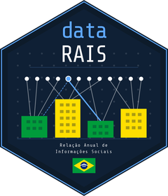

# datarais 

<!-- badges: start -->
[](https://github.com/gecomt/datarais/actions/workflows/R-CMD-check.yaml)
[](https://app.codecov.io/gh/gecomt/datarais?branch=main)
[](https://CRAN.R-project.org/package=datarais)
[](https://www.r-project.org/)
[](https://opensource.org/licenses/MIT)
[](https://lifecycle.r-lib.org/articles/stages.html#experimental)
[](https://huggingface.co/datasets/alexsandroprado/rais)
[](https://duckdb.org)
<!-- badges: end -->

*Read in [English](README.md)*

---

O **datarais** oferece acesso aos microdados da Relacao Anual de
Informacoes Sociais (RAIS) diretamente no R. O pacote cobre vinculos
empregaticos (1985-2025), estabelecimentos e trabalho domestico,
baixados do
[repositorio HuggingFace](https://huggingface.co/datasets/alexsandroprado/rais/tree/main/RAIS)
e armazenados em um banco [DuckDB](https://duckdb.org) local para
consultas SQL e `dplyr` rapidas, mesmo em bases de dezenas de gigabytes.

Os nomes das variaveis sao automaticamente normalizados para
**snake\_case em portugues**, consistentes entre todos os layouts e anos.

## Requisitos do sistema

- R >= 4.1.0
- [7-Zip](https://www.7-zip.org/download.html) -- obrigatorio para
  arquivos RAIS anteriores a 2020 (compressao PPMd). Nao necessario
  para 2020+ (LZMA).

## Instalacao

```r
# CRAN
install.packages("datarais")

# Versao de desenvolvimento
pak::pak("gecomt/datarais")
```

## Requisitos de hardware

| Recurso | Minimo | Recomendado |
|---------|--------|-------------|
| RAM | 8 GB | 16 GB |
| Disco livre | 20 GB por ano | SSD com 100+ GB |
| Internet | Banda larga estavel | 50 Mbps ou mais |

Estimativa de espaco em disco por ano de dados:

| Dado | Comprimido (.7z) | DuckDB |
|------|-----------------|--------|
| Vinculos, 1 ano (2020+) | 2-3 GB | 8-15 GB |
| Vinculos, 1 ano (anterior a 2018, por UF) | 1-2 GB | 5-10 GB |
| Estabelecimentos, 1 ano | 200-500 MB | 1-3 GB |
| Serie completa (1985-2025) | 80-120 GB | 300-500 GB |

## Uso rapido

```r
library(datarais)
library(dplyr)

# Verificar disponibilidade
rais_status()

# Baixar, parsear e carregar no DuckDB em uma linha
rais_load(
  years   = 2022:2023,
  type    = "vinculos",
  db_path = "rais.duckdb"
)

# Consultar com dplyr
con <- rais_connect("rais.duckdb")

tbl(con, "rais_novo") |>
  filter(ano == 2023) |>
  group_by(sigla_uf) |>
  summarise(
    n_vinculos    = n(),
    salario_medio = mean(vl_remun_media_nom, na.rm = TRUE)
  ) |>
  arrange(desc(salario_medio)) |>
  collect()

DBI::dbDisconnect(con, shutdown = TRUE)
```

## Selecionando o tipo de dado

```r
# So vinculos (padrao)
rais_load(years = 2022, type = "vinculos",         db_path = "rais.duckdb")

# So estabelecimentos
rais_load(years = 2022, type = "estabelecimentos", db_path = "rais.duckdb")

# Ambos
rais_load(years = 2022, type = "all",              db_path = "rais.duckdb")
```

## Download por estado (UF)

O parametro `state` se comporta de forma diferente dependendo do periodo.

**Anterior a 2018 (layout antigo):** os arquivos sao distribuidos por
UF, entao `state` funciona diretamente:

```r
rais_load(years = 2010, state = c("CE", "RN", "PB"), db_path = "rais.duckdb")
```

**2018 em diante (layout novo):** os arquivos sao distribuidos por
regiao geografica, entao `state` e **ignorado**. O arquivo da regiao
inteira e baixado; filtre por UF apos o carregamento:

```r
rais_load(years = 2022, db_path = "rais.duckdb")

con <- rais_connect("rais.duckdb")
tbl(con, "rais_novo") |> filter(sigla_uf == 23L)  # 23 = Ceara
```

| Arquivo (2018+) | UFs incluidas |
|---|---|
| `RAIS_VINC_PUB_NORDESTE.7z` | CE RN PB PE AL SE BA PI MA |
| `RAIS_VINC_PUB_NORTE.7z` | AM PA AC RO RR AP TO |
| `RAIS_VINC_PUB_SP.7z` | SP |
| `RAIS_VINC_PUB_MG_ES_RJ.7z` | MG ES RJ |
| `RAIS_VINC_PUB_SUL.7z` | PR SC RS |
| `RAIS_VINC_PUB_CENTRO_OESTE.7z` | MS MT GO DF |

## Tabelas no DuckDB

Todos os arquivos estao em `RAIS/<ano>/` no repositorio HuggingFace.
A distincao entre layout antigo e novo e feita pelos nomes dos arquivos
dentro de cada pasta de ano, nao por pastas separadas.

| Tabela | Conteudo | Periodo | Arquivo fonte |
|---|---|---|---|
| `rais_antigo` | Vinculos por UF | 1985-2017 | `RAIS/<ano>/<UF><ano>.7z` |
| `rais_novo` | Vinculos por regiao | 2018+ | `RAIS/<ano>/RAIS_VINC_PUB_<regiao>.7z` |
| `rais_estab` | Estabelecimentos | 1985+ | `RAIS/<ano>/ESTB<ano>.7z` ou `RAIS_ESTAB_PUB.7z` |

## Variaveis principais

| Variavel | Descricao |
|---|---|
| `sigla_uf` | Codigo IBGE da UF (ex: 23 = CE) |
| `id_municipio` | Codigo IBGE do municipio |
| `ano` | Ano de referencia |
| `vl_remun_media_nom` | Remuneracao media nominal (R$) |
| `vl_remun_media_sm` | Remuneracao media em salarios minimos |
| `qtd_horas_contratadas` | Horas semanais contratadas |
| `cnae20_subclasse` | CNAE 2.0 Subclasse (a partir de 2006) |
| `cbo_2002` | CBO Ocupacao 2002 (a partir de 2003) |
| `tipo_vinculo` | Tipo de vinculo empregaticio |
| `grau_instrucao` | Grau de instrucao |
| `raca_cor` | Raca/cor (a partir de 1999) |

Ver o dicionario completo de variaveis:

```r
rais_col_info()
rais_col_info(search = "remun")
```

## Layouts historicos

```r
rais_layouts()
```

| Periodo | Formato | Encoding | Compressao |
|---|---|---|---|
| 1985-2017 | Por UF | latin1 | PPMd (requer 7-Zip) |
| 2018-2019 | Por regiao | UTF-8 | PPMd (requer 7-Zip) |
| 2020+ | Por regiao | UTF-8 | LZMA |

## Atualizacao incremental

```r
# Baixa apenas os anos que ainda nao estao no banco
rais_update(db_path = "rais.duckdb")

# Incluir versoes parciais (ex: "2024 Parcial")
rais_update(db_path = "rais.duckdb", include_partial = TRUE)
```

## Exportar para Parquet

```r
rais_to_parquet(
  db_path      = "rais.duckdb",
  output_dir   = "parquet/",
  partition_by = "sigla_uf"
)
```

## Funcoes de conveniencia

```r
# Atalho para dplyr::tbl() -- seleciona a tabela correta automaticamente
con <- rais_connect("rais.duckdb")
rais_tbl(con, year = 2022)                  # rais_novo, filtrado por 2022
rais_tbl(con, type = "estabelecimentos")    # rais_estab
rais_tbl(con, table = "rais_antigo")        # nome direto

# Listar arquivos disponiveis no HuggingFace
rais_hf_files(years = 2023)
rais_hf_files(years = 2023, type = "vinculos")

# Baixar arquivos de layout (.xls/.xlsx)
rais_download_layouts(type = "vinculos", destdir = "layouts/")
```

## Suporte a idiomas

As mensagens sao exibidas em ingles por padrao e mudam automaticamente
para portugues brasileiro quando o locale do SO e `pt_BR`:

```r
rais_set_language("pt")   # mudar para portugues
rais_set_language("en")   # mudar para ingles
rais_set_language(NULL)   # restaurar deteccao automatica
rais_language()           # exibir idioma ativo e origem
```

O idioma tambem pode ser definido pela variavel de ambiente
`RAIS_LANGUAGE=pt` antes de iniciar o R.

## Dados de referencia

```r
data(uf_codigos)
head(uf_codigos)
#>   sigla codigo       regiao
#> 1    RO     11        Norte
#> 2    AC     12        Norte
```

## Referencia de funcoes

| Funcao | Descricao |
|---|---|
| `rais_load()` | Pipeline completo: download, parse e carga no DuckDB |
| `rais_update()` | Atualizacao incremental (baixa apenas anos novos) |
| `rais_download()` | Apenas download dos arquivos `.7z` |
| `rais_parse()` | Le e normaliza um unico arquivo `.7z` |
| `rais_parse_batch()` | Le e normaliza multiplos arquivos |
| `rais_connect()` | Abre conexao DuckDB |
| `rais_tbl()` | Referencia lazy `tbl` a uma tabela RAIS |
| `rais_to_duckdb()` | Grava um data frame no banco |
| `rais_to_parquet()` | Exporta tabelas para Parquet |
| `rais_info()` | Lista tabelas e contagens no banco |
| `rais_available()` | Lista anos disponiveis no HuggingFace |
| `rais_available_years()` | Vetor de inteiros com anos disponiveis |
| `rais_hf_files()` | Lista arquivos com tamanhos e URLs |
| `rais_status()` | Testa conectividade com o HuggingFace |
| `rais_rename_cols()` | Normaliza nomes de colunas |
| `rais_col_dictionary()` | Dicionario de mapeamento de colunas |
| `rais_col_info()` | Metadados de colunas (tipo, descricao, disponibilidade) |
| `rais_translate_cols()` | Traduz um vetor de nomes de colunas |
| `rais_layouts()` | Resumo dos layouts historicos |
| `rais_download_layouts()` | Baixa arquivos de layout do HuggingFace |
| `rais_set_language()` | Define o idioma (en/pt) |
| `rais_language()` | Exibe o idioma ativo |

## Documentacao

- Vignette (introducao): `vignette("datarais")`
- Vignette (serie historica): `vignette("serie-historica")`
- Referencia completa: `help(package = "datarais")`
- Site: <https://gecomt.github.io/datarais/>

## Cache e downloads em paralelo

Por padrao, os arquivos baixados ficam em um diretorio temporario e os downloads sao sequenciais, conforme a politica do CRAN. Para manter um cache persistente e baixar em paralelo:

```r
options(
  datarais.cache_dir = tools::R_user_dir("datarais", "cache"),
  datarais.workers   = 3
)
```

## Citacao

```r
citation("datarais")
```

```
Prado, A. (2025). datarais: Acesso aos Microdados da RAIS via HuggingFace e DuckDB.
Pacote R versao 0.1.0. https://github.com/gecomt/datarais
```

## Contribuicao

Contribuicoes sao bem-vindas. Consulte
[`CONTRIBUTING.md`](CONTRIBUTING.md) para as diretrizes.
Reporte problemas via [Issues](https://github.com/gecomt/datarais/issues).

## Licenca

MIT (c) 2025 Alexsandro Prado
